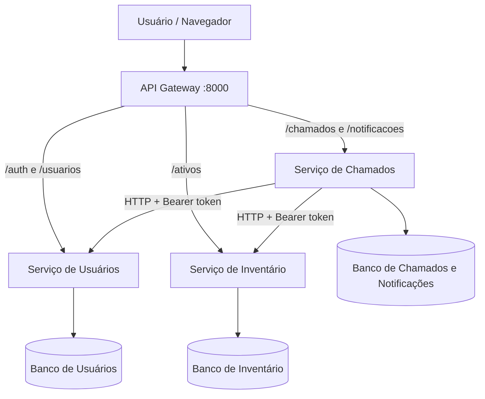

# HelpDesk TI · arquitetura de microsserviços

> **Vídeo de demonstração (4 a 6 minutos):** [COLE AQUI O LINK NÃO LISTADO DO YOUTUBE OU DO GOOGLE DRIVE]
>
> **Repositório individual:** [COLE AQUI O LINK DO SEU REPOSITÓRIO NO GITHUB]

Projeto da disciplina de Arquitetura de Software — evolução do HelpDesk TI monolítico para uma arquitetura distribuída com três microsserviços, bancos isolados e API Gateway.

## 1. Arquitetura proposta



O Gateway é o único componente publicado para a máquina do usuário. Ele encaminha as rotas para o serviço responsável e também entrega os arquivos da interface web. A URL da tela continua sendo `http://localhost:8000`.

### Responsabilidade de cada serviço

| Componente | Responsabilidade | Persistência |
|---|---|---|
| Gateway | Ponto único de entrada, roteamento HTTP, arquivos da interface e verificação de saúde dos serviços | Não possui banco |
| Usuários | Login, emissão de JWT, consulta e cadastro de usuários | `usuarios.db` |
| Inventário | Cadastro e consulta de equipamentos | `inventario.db` |
| Chamados | Abertura, atribuição, SLA, status, comentários, painel e notificações | `chamados.db` |

## 2. Como executar

Pré-requisitos: Docker e Docker Compose instalados.

1. Crie o arquivo de configuração:

   ```bash
   cp .env.example .env
   ```

2. Gere uma chave segura:

   ```bash
   python -c "import secrets; print(secrets.token_urlsafe(48))"
   ```

3. Copie o resultado e coloque-o no campo `JWT_SEGREDO` do arquivo `.env`. A mesma chave é compartilhada pelos três serviços para que todos validem os mesmos tokens. Não envie o arquivo `.env` ao GitHub.

4. Na pasta do projeto, suba a arquitetura completa:

   ```bash
   docker compose up --build
   ```

5. Confira os contêineres:

   ```bash
   docker compose ps
   ```

6. Acesse a interface e a saúde do sistema:

   - Interface: <http://localhost:8000>
   - Saúde do gateway: <http://localhost:8000/saude>
   - Documentação da API de Usuários: <http://localhost:8000/docs>

Para executar em segundo plano, acrescente `-d`: `docker compose up --build -d`. Para acompanhar os logs: `docker compose logs -f`. Para desligar: `docker compose down`. Os dados permanecem nos volumes Docker; para remover também os bancos de demonstração, use `docker compose down -v`.

## 3. Contas para demonstração

Todas as contas de exemplo usam a senha `Helpdesk2026` por padrão. É possível alterá-la em `SENHA_EXEMPLO` no `.env` antes da primeira inicialização dos bancos.

| E-mail | Perfil | Permissões principais |
|---|---|---|
| `admin@empresa.com` | Administrador | Acesso administrativo e cadastro de usuários |
| `carla@empresa.com` | Técnica | Visualiza chamados, atribui, resolve e cadastra equipamentos |
| `diego@empresa.com` | Técnico | Mesmas permissões da Carla |
| `ana@empresa.com` | Solicitante | Abre chamados e visualiza apenas os próprios |
| `bruno@empresa.com` | Solicitante | Abre chamados e visualiza apenas os próprios |

## 4. Comunicação entre serviços

- O Gateway encaminha `/auth/*` e `/usuarios*` para Usuários, `/ativos*` para Inventário e `/chamados*` e `/notificacoes*` para Chamados.
- Quando um chamado é aberto com um equipamento, Chamados consulta `GET /ativos/{id}` no Inventário.
- Quando um técnico é atribuído, Chamados consulta `GET /usuarios/{id}` em Usuários e valida o perfil retornado.
- As chamadas internas usam HTTP, encaminham o cabeçalho `Authorization: Bearer ...` e têm timeout configurado.
- Se uma dependência estiver fora do ar, Chamados responde `503 Service Unavailable` com mensagem clara. As consultas de usuários e chamados continuam disponíveis quando o Inventário está parado.

## 5. Bancos e independência

Cada serviço recebe seu próprio `DATABASE_URL` e volume persistente. Não há leitura direta nem escrita no banco de outro serviço. Os campos `solicitante_id`, `tecnico_id` e `ativo_id` no banco de Chamados são identificadores de referência, e não chaves estrangeiras para tabelas externas. A única relação relacional em Chamados é entre o chamado e seus próprios comentários.

Os bancos são armazenados em volumes distintos:

- `dados_usuarios`
- `dados_inventario`
- `dados_chamados`

## 6. Segurança

- Login emite JWT assinado; os serviços validam assinatura, emissor, expiração e perfil antes de liberar suas rotas.
- Chamados repassa o token do usuário nas consultas internas a Usuários e Inventário.
- As permissões por perfil são mantidas: solicitantes veem somente seus chamados; técnicos e administradores podem visualizar e operar os chamados conforme as regras do sistema.
- O segredo `JWT_SEGREDO` vem do `.env`, exige pelo menos 32 caracteres na execução em microsserviços e não fica no código.
- Apenas o Gateway publica a porta `8000`. Os serviços e bancos ficam na rede Docker, sem portas publicadas no host.
- São mantidas proteções HTTP, limite de tamanho de requisição e respostas sem detalhes internos do banco.

## 7. Regras funcionais preservadas

- Prioridades e SLA: crítica 4 horas, alta 8 horas, média 24 horas e baixa 72 horas.
- Transições: aberto → em atendimento → resolvido → fechado; um chamado resolvido pode ser reaberto.
- Um técnico precisa ser validado no serviço de Usuários antes da atribuição.
- Equipamentos são validados no Inventário antes de abrir um chamado vinculado.
- Comentários, painel, notificações e permissões por perfil continuam disponíveis.

## 8. Decisões de arquitetura e trade-offs

1. **Gateway dedicado:** concentra o acesso externo e permite mudar o endereço interno dos serviços sem alterar a interface web.
2. **Banco por serviço:** reduz acoplamento e permite que cada equipe evolua seu modelo de dados. Em contrapartida, consultas que envolvem dados de outro domínio precisam usar APIs.
3. **JWT validado em cada serviço:** evita uma consulta central de autenticação em toda requisição. A contrapartida é que a revogação imediata de um token emitido exige uma estratégia adicional, como lista de revogação ou tokens de curta duração.
4. **HTTP síncrono entre Chamados, Usuários e Inventário:** mantém a validação consistente no momento da operação. A contrapartida é que a indisponibilidade de uma dependência pode impedir a operação que precisa dela; o timeout e o `503` evitam espera indefinida.
5. **SQLite com volumes separados:** simplifica a execução didática e demonstra a independência dos dados. Em produção, cada serviço poderia usar uma instância gerenciada de PostgreSQL.
6. **Notificações no domínio de Chamados:** foram mantidas no banco exclusivo de Chamados para preservar a funcionalidade sem compartilhar banco. A fila assíncrona de eventos (`ChamadoAberto`, `ChamadoAtribuido` e `ChamadoResolvido`) fica como evolução futura/bônus.

## 9. Testes

Execute os testes do projeto com:

```bash
pip install -r requirements-dev.txt
pytest -q
```

Os testes cobrem as regras funcionais e de segurança do projeto-base. Também foram adicionados testes de validação do token distribuído, comunicação HTTP e falha de dependência.

## 10. Roteiro do vídeo obrigatório (4 a 6 minutos)

Grave a tela com sua voz. O vídeo pode ser simples, sem edição. O roteiro falado e os comandos estão em [docs/ROTEIRO_VIDEO.md](docs/ROTEIRO_VIDEO.md). Sugestão de sequência:

| Tempo | O que mostrar e explicar |
|---|---|
| 0:00–0:40 | Mostrar este diagrama. Explicar Gateway, os três serviços e os três bancos independentes. |
| 0:40–1:10 | Executar `docker compose up --build -d` e `docker compose ps`. Mostrar os quatro contêineres saudáveis. |
| 1:10–2:20 | Abrir `http://localhost:8000`, entrar como Carla, abrir chamado, atribuir, resolver e fechar. Explicar que a tela usa o Gateway. |
| 2:20–3:00 | Mostrar uma chamada sem token retornando 401 e entrar como Ana para comprovar que ela não acessa chamado de outro solicitante. |
| 3:00–3:30 | Mostrar os três volumes separados com `docker volume ls` e explicar que cada banco pertence a um serviço. |
| 3:30–4:30 | Executar `docker compose stop inventario`. Mostrar que `/usuarios` e `/chamados` continuam funcionando e tentar abrir chamado com equipamento para obter 503. Depois executar `docker compose start inventario`. |
| 4:30–5:20 | Explicar o que melhorou (deploy e dados independentes) e o que ficou mais complexo (rede, timeout, falha de dependência e observabilidade). Mostrar o resultado de `pytest -q`, se couber. |

### Comandos úteis para a demonstração de segurança e falha

```bash
# Sem token: deve responder 401
curl -i http://localhost:8000/chamados

# Estado dos serviços
curl http://localhost:8000/saude

# Volumes separados
docker volume ls

# Simular falha e recuperar Inventário
docker compose stop inventario
docker compose start inventario
```

Para testar a permissão do solicitante, entre na interface como `ana@empresa.com` e tente consultar o identificador de um chamado pertencente a Bruno pela rota `GET /chamados/{id}`: o resultado deve ser 404, sem revelar a existência do chamado.

## 11. Estrutura do projeto

```text
app/                    Código compartilhado e interface web
  auth/                 Login, JWT, senhas e proteção contra tentativas
  chamados/             Modelos e esquemas do domínio de chamados
  inventario/           Modelos, esquemas e regras de inventário
  usuarios/              Modelos, esquemas e regras de usuários
  notificacoes/          Modelo das notificações no domínio de Chamados
services/
  common/                Autenticação JWT e cliente HTTP entre serviços
  usuarios/main.py       Aplicação independente de Usuários
  inventario/main.py     Aplicação independente de Inventário
  chamados/main.py       Aplicação independente de Chamados
  chamados/domain.py     Regras e integração HTTP de Chamados
gateway/main.py          API Gateway e entrega da interface web
docker-compose.yml       Orquestração dos quatro contêineres
Dockerfile               Imagem executável pelos serviços e Gateway
tests/                   Testes do projeto-base
```
